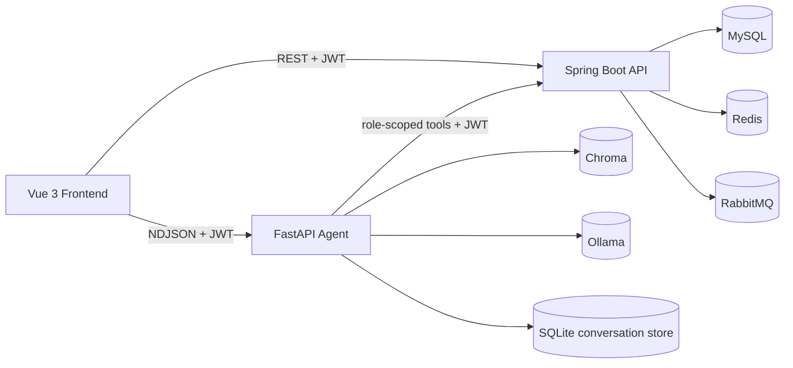

# E-Commerce-Platform

一个面向学习与项目展示的全栈电商平台，包含管理员、买家和卖家三种角色。项目覆盖商品、购物车、订单、模拟支付、退款、评价、通知、卖家统计与 AI 助手，并重点处理权限边界、订单一致性、缓存安全和异步通知。

## 核心能力

- 三角色登录、刷新和退出登录，接口权限与数据归属同时校验。
- 多卖家订单拆分、下单幂等、商品快照、原子库存扣减、超时关单和退款恢复库存。
- 订单事务提交后发布 RabbitMQ 事件，消费端通过唯一键保证重复投递不产生重复副作用。
- 商品缓存、Bloom Filter、空值缓存和缓存重建控制，降低穿透、击穿与雪崩风险。
- Flyway 统一管理数据库结构和演示数据。
- AI 助手通过 JWT 工具访问 Java 业务接口，不直接连接数据库；支持 RAG、实时业务查询、流式回答和写操作二次确认。
- SQLite 保存带滑动 TTL 的 AI 对话历史，服务重启后仍可恢复。
- Actuator、健康检查和 Trace ID 提供基础运行可观测性。
- GitHub Actions 覆盖 Java、Python Agent 和 Vue 前端检查。

## 角色与功能

### 管理员

- 查看平台概览、全部订单和订单详情。
- 查询和删除买家、卖家账号。
- 管理商品分类的新增、修改、启停和删除。
- 强制关闭异常订单。
- 查看和修改管理员个人资料。

### 买家

- 浏览分类、搜索商品、查看商品详情和评价。
- 管理购物车、创建订单、模拟支付、取消订单和确认收货。
- 提交或撤销退款申请。
- 对已完成订单发表评价。
- 查看通知、维护个人资料和修改密码。

### 卖家

- 创建、修改、上下架和删除自己的商品。
- 查看包含自己商品的订单并执行发货。
- 审批买家退款申请。
- 查看和回复商品评价。
- 查看今日、最近 7 天、最近 30 天和全部收入统计。

### AI 助手

- 理解自然语言并查询商品、订单、购物车、退款、通知和统计。
- 根据当前角色开放不同工具，敏感操作必须由用户二次确认。
- 通过 Chroma 检索 FAQ、政策和商品描述。
- 通过 Java API 获取实时价格、库存、订单和账号数据。
- 支持真实分块流式输出和 SQLite 对话历史恢复。

## 系统架构



Java 后端负责认证、权限、事务、库存和数据库访问；AI Agent 只通过受控工具调用后端接口。RAG 用来保存 FAQ、政策和商品描述，实时价格、库存、订单与退款数据始终来自 Java API。

## 关键链路

### 认证与授权

登录成功后返回短期 Access JWT，并通过 HttpOnly Cookie 保存 Refresh Token。Refresh Token 只以哈希形式存入 Redis，刷新时原子消费并轮换。Spring Security 负责接口角色校验，Service 层继续校验数据归属。

### 下单与库存

一次结算会先校验购物车和幂等键，再按卖家拆分为多张独立订单。订单明细保存商品快照，库存通过带剩余量条件的 SQL 原子扣减。任一商品库存不足时，订单、明细、库存和购物车修改会一起回滚。

### 异步通知

订单事务提交后发布 RabbitMQ 事件。消费端使用订单和事件类型组成的唯一键实现幂等，重复投递不会重复创建通知。发布端启用 publisher confirm 和有限重试，超过重试上限的消息进入死信队列。

### AI 工具调用

Agent 先校验用户 JWT，再根据问题选择账户工具、RAG、接口目录或外部搜索。写操作只生成待确认建议，用户回复“确认”后才调用 Java 写接口。Java 后端会再次校验角色和数据归属。

## 技术栈

- Java 17、Spring Boot 3、Spring Security、JWT、MyBatis-Plus
- MySQL、Redis、RabbitMQ、Flyway
- Vue 3、Vite、Pinia、Vue Router、Element Plus
- Python、FastAPI、LangChain、LangGraph、Ollama、Chroma
- JUnit 5、Mockito、MockMvc、H2、Testcontainers
- GitHub Actions、Docker Compose

## 工程亮点

- 订单与库存：幂等键、卖家拆单、订单明细快照、条件库存更新和事务回滚。
- 消息可靠性：事务提交后发布、publisher confirm、有限重试和死信队列。
- 认证边界：15 分钟 Access JWT，Refresh Token 使用 HttpOnly Cookie 和 Redis 哈希原子轮换。
- AI 安全边界：角色白名单工具、外部内容不可信、写操作二次确认。
- AI 对话体验：真实模型分块流式输出、结构化确定性回答、SQLite 滑动 TTL。
- 可测试性：业务集成测试与真实中间件 Testcontainers 测试分层覆盖。

## 项目结构

```text
src/main/java/          Java 后端业务代码
src/main/resources/    配置与 Flyway 数据库迁移
src/test/java/         单元测试、集成测试和真实中间件测试
frontend/              Vue 3 前端
ai-agent/              FastAPI AI Agent
docs/                  架构和面试复习文档
loadtest/              JMeter 压测脚本
```

后端按 Controller、Service、Mapper、Entity、DTO 和 VO 分层。Agent 将知识检索、业务工具、外部搜索、对话持久化和 HTTP 入口拆分为独立模块，便于测试和维护。

## 文档

- [架构与关键设计](docs/architecture.md)
- [面试复习与项目介绍](docs/interview-guide.md)
- [AI Agent 说明](ai-agent/README.md)

## 测试

当前已验证：

- Java：`49` 个测试通过，覆盖权限、认证、商品、购物车、订单拆分、库存竞争、支付、退款、评价、通知、统计和 RabbitMQ 重复消费。
- Python Agent：`50` 个测试通过，覆盖意图路由、工具权限、两阶段确认、推荐分类、SQLite TTL、历史恢复和流式分块。
- Vue 前端：生产构建通过。

项目中的支付和退款为模拟流程，Docker Compose 面向本地运行和演示，不描述为生产级高可用部署。
