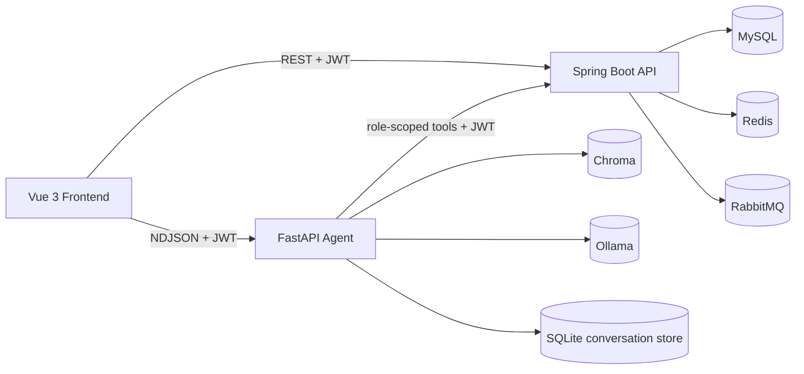

# E-Commerce-Platform

一个面向学习与项目展示的全栈电商平台，包含管理员、买家和卖家三种角色。项目覆盖商品、购物车、订单、模拟支付、退款、评价、通知、卖家统计与 AI 助手，并重点处理权限边界、订单一致性、缓存安全和异步通知。

## 核心能力

- 三角色登录、刷新和退出登录，接口权限与数据归属同时校验。
- 多卖家订单拆分、下单幂等、商品快照、原子库存扣减、超时关单和退款恢复库存。
- 订单事务提交后发布 RabbitMQ 事件，消费端通过唯一键保证重复投递不产生重复副作用。
- 商品缓存、Bloom Filter、空值缓存和缓存重建控制，降低穿透、击穿与雪崩风险。
- Flyway 统一管理数据库结构和演示数据。
- AI 助手通过 JWT 工具访问 Java 业务接口，不直接连接数据库；支持 RAG、实时业务查询、流式回答和写操作二次确认。
- SQLite 保存带滑动 TTL 的 AI 对话历史，服务重启后仍可恢复。
- Actuator、健康检查和 Trace ID 提供基础运行可观测性。
- GitHub Actions 覆盖 Java、Python Agent 和 Vue 前端检查。

## 系统架构

Java 后端负责认证、权限、事务、库存和数据库访问；AI Agent 只通过受控工具调用后端接口。RAG 用来保存 FAQ、政策和商品描述，实时价格、库存、订单与退款数据始终来自 Java API。

## 技术栈

- Java 17、Spring Boot 3、Spring Security、JWT、MyBatis-Plus
- MySQL、Redis、RabbitMQ、Flyway
- Vue 3、Vite、Pinia、Vue Router、Element Plus
- Python、FastAPI、LangChain、LangGraph、Ollama、Chroma
- JUnit 5、Mockito、MockMvc、H2、Testcontainers
- GitHub Actions、Docker Compose

## 工程亮点

- 订单与库存：幂等键、卖家拆单、订单明细快照、条件库存更新和事务回滚。
- 消息可靠性：事务提交后发布、publisher confirm、有限重试和死信队列。
- 认证边界：15 分钟 Access JWT，Refresh Token 使用 HttpOnly Cookie 和 Redis 哈希原子轮换。
- AI 安全边界：角色白名单工具、外部内容不可信、写操作二次确认。
- AI 对话体验：真实模型分块流式输出、结构化确定性回答、SQLite 滑动 TTL。
- 可测试性：业务集成测试与真实中间件 Testcontainers 测试分层覆盖。

## 文档

- [架构与关键设计](docs/architecture.md)
- [面试复习与项目介绍](docs/interview-guide.md)
- [AI Agent 说明](ai-agent/README.md)

## 测试

当前已验证：

- Java：`49` 个测试通过。
- Python Agent：`50` 个测试通过。
- Vue 前端：生产构建通过。

项目中的支付和退款为模拟流程，Docker Compose 面向本地运行和演示，不描述为生产级高可用部署。
