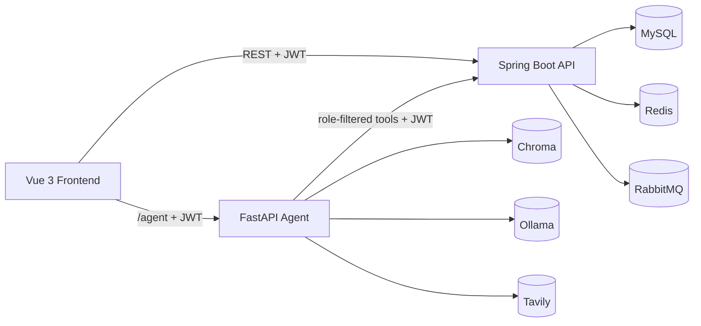
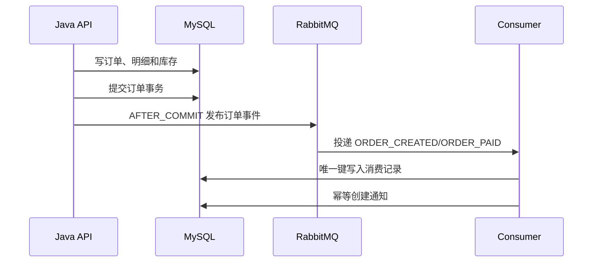

# E-Commerce Platform 面试复习与项目介绍

> 用途：本文基于当前最终版仓库整理，适合面试前快速复习、准备项目讲稿和回答
> 技术追问。文中明确区分“当前已实现”和“生产化扩展方向”，不要把规划中的能力
> 说成已经完成。

## 一、项目定位

项目名称：

**三角色智能电商平台｜Java 后端、Vue 3 前端、Python AI Agent**

一句话介绍：

> 一个包含管理员、买家、卖家三种角色的全栈电商项目，覆盖商品、购物车、订单、
> 支付模拟、退款、评价、通知、卖家统计和 AI 助手，并实现了缓存安全、订单一致性、
> RabbitMQ 异步通知、幂等消费、链路追踪和 Docker 一键部署。

项目重点不是单纯完成 CRUD，而是解决以下问题：

1. 多角色权限和数据归属如何保证。
2. 并发下单如何避免超卖和重复订单。
3. 订单成功但消息丢失时如何保证最终一致性。
4. AI 助手如何既能执行操作，又不越权、不直接接触数据库。
5. 如何用测试、监控、Trace ID 和 CI 验证关键链路。

## 二、技术栈逐项介绍

### 2.1 前端

| 技术 | 简单说明 | 项目中的作用 |
| --- | --- | --- |
| Vue 3 | 渐进式前端框架 | 构建买家、卖家、管理员三类页面 |
| Vite | 开发服务器和构建工具 | 快速启动、热更新和生产打包 |
| Pinia | Vue 状态管理 | 保存登录用户、聊天状态和跨页面数据 |
| Vue Router | 前端路由 | 页面跳转、路由守卫和角色页面隔离 |
| Element Plus | Vue 3 UI 组件库 | 表格、表单、弹窗、分页和消息提示 |
| Axios | HTTP 请求库 | 调用 Java API，统一处理 JWT 和错误 |

### 2.2 Java 后端

| 技术 | 简单说明 | 项目中的作用 |
| --- | --- | --- |
| Java 17 | LTS Java 版本 | Spring Boot 3 的运行基础 |
| Spring Boot 3.3.6 | 后端应用框架 | Web、分层、事务、定时任务和配置管理 |
| Spring Security | 安全框架 | JWT 过滤器、认证、授权和三角色访问控制 |
| JWT | 无状态身份令牌 | 保存用户 ID、角色和过期时间 |
| MyBatis-Plus | ORM 持久层框架 | Lambda 查询、分页、逻辑删除和条件更新 |
| Jakarta Validation | 参数校验规范 | 校验登录、商品、订单和资料请求 |
| Knife4j/OpenAPI | API 文档工具 | 查看和调试后端 REST 接口 |

### 2.3 数据和中间件

| 技术 | 简单说明 | 项目中的作用 |
| --- | --- | --- |
| MySQL 8.4 | 关系型数据库 | 用户、商品、购物车、订单、退款和评价 |
| Redis 7.4 | 内存数据库 | 商品缓存、哈希 Refresh Token 和缓存锁 |
| Flyway | 数据库迁移工具 | 用版本化 SQL 管理表结构和索引 |
| RabbitMQ 3.13 | 消息中间件 | 异步处理订单事件和通知 |
| 幂等消费 | 重复消息处理机制 | 防止重复通知和重复业务副作用 |

### 2.4 可观测性

| 技术 | 简单说明 | 项目中的作用 |
| --- | --- | --- |
| Actuator | Spring Boot 运维端点 | 健康检查和应用信息 |
| X-Trace-Id | 链路标识 | 串联 HTTP、RabbitMQ 消息和消费日志 |

### 2.5 AI Agent

| 技术 | 简单说明 | 项目中的作用 |
| --- | --- | --- |
| FastAPI | Python Web 框架 | 提供 `/chat`、流式聊天、健康和指标接口 |
| LangChain | LLM 应用框架 | 模型、工具、Prompt、Embedding 和向量库接入 |
| LangGraph | 状态图编排框架 | 组织意图路由、检索、工具调用和回答节点 |
| Ollama | 本地模型运行环境 | 运行 `qwen3:2b` 和 embedding 模型 |
| Chroma | 向量数据库 | 保存 FAQ、政策和商品描述向量 |
| Tavily | 外部搜索 API | 查询新闻、行情等外部实时信息 |

### 2.6 测试与部署

| 技术 | 简单说明 | 项目中的作用 |
| --- | --- | --- |
| JUnit 5 | Java 测试框架 | 单元测试和集成测试 |
| Mockito | Mock 框架 | 隔离依赖，验证 Service 业务逻辑 |
| MockMvc | Web 层测试工具 | 测试 Controller、权限和返回结构 |
| Testcontainers | 真实依赖容器测试 | 启动真实 MySQL、Redis 和 RabbitMQ |
| Docker Compose | 多容器编排 | 一键启动完整项目 |
| Nginx | Web 服务器和反向代理 | 托管前端并代理 API、上传和 Agent |
| GitHub Actions | CI 工具 | 自动运行 Java、Agent 和前端任务 |

## 三、简历写法

### 3.1 推荐版本

**三角色智能电商平台｜个人项目**

技术栈：`Java 17`、`Spring Boot 3`、`Spring Security`、`JWT`、`MyBatis-Plus`、
`MySQL`、`Redis`、`RabbitMQ`、`Vue 3`、`FastAPI`、`LangGraph`、`Docker Compose`

- 设计管理员、买家、卖家三角色认证和接口权限，使用 15 分钟无状态 Access JWT、
  HttpOnly Refresh Cookie 和 Redis 哈希轮换实现登录、刷新和退出登录闭环。
- 实现多卖家订单拆分、下单幂等、商品快照、原子库存扣减、超时关单、
  库存恢复、退款和确认收货流程，保证订单状态与库存一致。
- 使用事务提交后事件发布、RabbitMQ 和消费端唯一键实现异步通知；通过幂等消费、
  事务和并发测试处理重复支付、重复投递和库存竞争。
- 基于 Redis 读缓存、空值缓存、Guava Bloom Filter 和单飞锁处理缓存穿透、
  击穿和雪崩，并批量优化订单详情查询避免 N+1。
- 实现 FastAPI + LangChain/LangGraph Agent，通过 JWT 工具查询和操作用户数据；
  RAG 与实时数据分离，写操作采用两阶段确认，支持流式输出和 Tavily 外部搜索。
- 使用 Actuator、Agent 轻量指标、Trace ID、Testcontainers、Docker Compose 和
  GitHub Actions 完善健康检查、测试和部署。

### 3.2 精简版本

- 基于 Spring Boot 3、MySQL、Redis 和 RabbitMQ 实现三角色电商后端，
  覆盖认证、商品、购物车、订单、退款、评价、通知和统计。
- 使用幂等键、条件库存更新和订单拆单保证订单一致性，并通过 RabbitMQ 异步生成通知。
- 构建 FastAPI Agent，通过角色化工具调用 Java API，实现 RAG、实时业务查询、
  流式回答和二次确认写操作。

### 3.3 不要这样写

- 不要声称 Agent 直接查询 MySQL。
- 不要声称项目已经接入真实支付。
- 不要把本地内存会话说成分布式会话。
- 不要把 Docker Compose 说成生产级高可用部署。
- 不要虚构并发量、QPS 或模型准确率。
- 不要把所有功能说成“高并发”，项目中重点验证的是关键一致性场景。

## 四、90 秒项目讲稿

> 这是一个三角色智能电商平台。Vue 3 前端负责买家、卖家和管理员页面，
> Spring Boot 后端负责认证、权限、商品、购物车、订单、退款和统计，
> Python Agent 通过带 JWT 的 Java 工具完成商品、订单、购物车和退款操作。
>
> 项目的核心不是普通 CRUD，而是三条链路。第一条是订单链路，我使用幂等键、
> 多卖家拆单、商品快照和带库存条件的原子更新，避免重复下单和超卖。第二条是
> 异步通知链路，订单事务提交后发布事件，RabbitMQ 消费者用唯一键做幂等，
> 避免重复通知。第三条是 AI 操作链路，Agent 不访问
> 数据库，只调用 Java API；RAG 只负责 FAQ 和商品描述，价格、库存和订单实时查询，
> 写操作必须经过用户二次确认。
>
> 项目后期补充了 Redis 缓存防护、N+1 优化、Trace ID、Actuator 健康检查、
> Agent 轻量指标、Testcontainers、Docker Compose 和 GitHub Actions。当前 Java
> 测试 50 个，Agent 测试 50 个，前端生产构建和 CI 均通过。

## 五、系统架构



系统边界：

1. Java 后端拥有认证、授权、事务、库存和数据库访问权。
2. Agent 不直接连接 MySQL，所有业务事实和写操作都经 Java API。
3. Redis 保存缓存和令牌状态，不承担业务永久数据存储。
4. RabbitMQ 负责异步事件，不是订单主数据源。
5. Chroma 保存语义知识，不保存实时价格和库存。

## 六、三角色与功能模块

### 6.1 管理员

- 买家、卖家账号查询和删除。
- 商品分类新增、修改、启停和删除。
- 全部订单查询、详情和强制关单。
- 管理员个人资料和密码修改。

### 6.2 买家

- 商品搜索、分类浏览、商品详情和评价。
- 购物车数量修改、删除、清空。
- 下单、模拟支付、取消、确认收货。
- 退款申请和撤销。
- 已完成订单评价。
- 通知查看和已读。
- 个人资料和密码修改。

### 6.3 卖家

- 商品新增、修改、上下架和删除。
- 查看包含自己商品的订单。
- 发货。
- 同意或拒绝退款。
- 查看和回复评价。
- 查看今日、7 天、30 天和全部收入统计。

### 6.4 Agent

- 商品搜索、详情、评价和推荐。
- 购物车查询和加入购物车。
- 订单查询、支付引导、取消和确认操作。
- 退款、通知、卖家统计和管理员工具。
- FAQ、政策和商品描述语义检索。
- Tavily 外部实时搜索。

## 七、后端核心链路

### 7.1 请求链路

```text
HTTP 请求
  -> Spring Security JWT 过滤器
  -> Controller 参数校验
  -> Service 事务和业务规则
  -> MyBatis-Plus / MySQL / Redis
  -> Result 统一响应
  -> X-Trace-Id 响应头和日志
```

### 7.2 认证与授权

- 三种身份分别存储在 `user_admin`、`user_buyer`、`user_seller`。
- 登录必须提供角色、用户名和密码。
- Access JWT 默认 15 分钟，请求时只验签，不查询 Redis。
- Refresh Token 默认 7 天，通过 HttpOnly Cookie 传输，Redis 只保存 SHA-256 哈希。
- Refresh Token 在 Redis 中原子消费并轮换，旧 Token 立即失效。
- 退出登录删除 Refresh Token 并清除 Cookie，不维护 Access Token 黑名单。
- 接口通过 Spring Security 和 `@PreAuthorize` 校验角色。
- 卖家操作商品或订单时还要校验数据归属。

面试重点：

> 项目不要求退出后所有 Access Token 立即失效，因此保留短生命周期 JWT 的无状态
> 访问优势，只对 Refresh Token 做服务端状态管理。退出后无法继续刷新，已经签发的
> Access Token 最多残留 15 分钟；如果未来要求立即全端失效，再切换到 Redis Session。

### 7.3 商品与缓存

- 商品详情使用 Redis 读缓存。
- 不存在商品写入空值缓存，减少穿透。
- Guava Bloom Filter 在访问 Redis 和数据库前拦截不可能的 ID。
- 缓存重建使用 Redis 单飞锁，避免大量请求同时查库。
- 缓存 TTL 加入随机化，降低集中失效风险。

面试重点：

> 布隆过滤器解决的是“肯定不存在”的请求；空值缓存解决重复查询不存在的数据；
> 单飞锁解决热点 Key 失效后大量并发回源；随机 TTL 解决大量 Key 同时失效。

### 7.4 购物车与下单

```text
检查幂等键
  -> 校验买家资料和购物车
  -> 按卖家分组
  -> 每个卖家创建独立订单
  -> 写订单商品快照
  -> 原子扣库存
  -> 删除已结算购物车项
  -> 事务提交后发布订单事件
```

关键设计：

1. 一次结算使用 `checkout_group_id`，便于查询一次结算产生的多张订单。
2. 每张订单有独立订单号、卖家、状态、金额和售后流程。
3. `order_item` 保存商品名称、图片和价格快照，防止商品后来修改影响历史订单。
4. 幂等键防止重复点击生成多组订单。
5. 任一商品库存不足时，整个事务回滚。

### 7.5 库存并发

核心 SQL：

```sql
UPDATE product
SET stock = stock - ?
WHERE id = ?
  AND stock >= ?
```

正确性依赖数据库条件更新，而不是“先查询再更新”。并发下只有一个请求能命中
库存条件，其他请求得到更新行数 0 并返回库存不足。

### 7.6 订单状态与超时

```text
0 待付款
1 待发货
2 待收货
3 已完成
4 已取消
```

- 待付款订单超时后取消并恢复库存。
- 卖家发货后订单进入待收货。
- 发货 24 小时后可自动完成。
- 发货后至完成前可以申请退款。
- 退款必须经卖家同意，同意后恢复库存并完成模拟退款。

### 7.7 RabbitMQ 与幂等消费



设计说明：

1. 订单核心数据以数据库事务为准。
2. RabbitMQ 只承载非关键异步通知，不在订单主事务中直接发送。
3. 使用 `@TransactionalEventListener(AFTER_COMMIT)` 避免数据库回滚后产生幽灵消息。
4. 消费端通过 `(order_id, event_type)` 唯一键实现幂等。
5. 发布确认失败时有限重试，超过上限进入死信队列并保留日志。

### 7.8 退款与评价

- 同一订单商品只能申请一次退款。
- 退款申请只能由买家撤销或由对应卖家处理。
- 退款审批、库存恢复和状态修改由事务包裹。
- 已退款商品不能评价。
- 只有已完成订单可以评价。
- 同一订单商品只能评价一次。
- 评价内容为空时不能发布。
- 卖家可以回复评价。

### 7.9 通知

- 订单创建和支付事件通过 RabbitMQ 异步创建通知。
- 通知使用 `(order_id, event_type, role, recipient_id)` 唯一约束。
- 消费记录和通知写入放在同一事务，避免半完成状态。
- 重复消息不会重复创建通知。

### 7.10 可观测性

Java 后端通过 Actuator 提供健康检查和基础应用信息；RabbitMQ 发布确认、
消费和失败情况通过日志记录。Agent 暴露轻量进程内指标，覆盖请求、检索、工具、
对话数量和 TTL 清理。

Trace 链路：

```text
HTTP X-Trace-Id
  -> MDC 日志
  -> RabbitMQ 消息
  -> order_event_record.trace_id
  -> 消费端 MDC
```

### 7.11 批量查询和索引

订单列表原本容易产生 N+1：

- 每个订单查一次明细。
- 每个商品查一次商品信息。
- 每个订单查一次买家和卖家。
- 每个订单查一次评价。

优化后使用 `/page-details` 批量查询，一次加载订单、明细、商品、卖家、买家和评价，
再在内存中按订单分组组装。

重点索引：

| 索引 | 主要查询 |
| --- | --- |
| `order_info.seller_id` | 卖家订单列表 |
| `order_info.status + create_time` | 状态分页、超时关单、自动完成 |
| `order_item.order_id` | 订单明细查询 |
| `order_item.product_id` | 历史订单归属和商品统计 |
| `product_review.product_id` | 评价分页和评分聚合 |
| `LOWER(user_seller.shop_name)` | 店铺名忽略大小写和前缀匹配 |

## 八、前端核心设计

- `BuyerLayout`、`SellerLayout`、`AdminLayout` 区分三类工作区。
- 路由守卫允许游客访问商品和详情，其他页面按角色限制。
- Axios 统一注入 access token。
- Access Token 只保存在内存；页面刷新后使用 HttpOnly Cookie 调用刷新接口恢复。
- 401 时单飞调用刷新接口，刷新失败再退出登录。
- Pinia 保存用户、购物车和 AI 会话。
- 订单页面支持状态卡、时间节点、到货提示、退款和评价。
- AI 页面使用 `ReadableStream` 处理 NDJSON 流式响应。

## 九、Agent 完整设计

### 9.1 Agent 和目标

Agent 不是简单的商品问答机器人，而是受权限约束的业务助手：

1. 用自然语言查询商品、订单、购物车、评价和统计。
2. 根据渠道选择知识库、实时 API 或 Tavily。
3. 在用户确认后执行受控写操作。
4. 不让模型接触数据库凭据。

### 9.2 早期思考和最终方案

最初的想法是：

1. 接入 Tavily 实现联网。
2. 把后端接口、接口功能、数据库地址和端口加入知识库或提示词。
3. 让模型识别关键词，再选择查知识库、联网或请求后端。
4. 保留加入购物车等工具操作。

最终改进为：

1. 后端接口放入结构化 `api_catalog.json`，按角色过滤。
2. 数据库地址、端口、用户名、密码和 JDBC URL 不进入模型上下文。
3. 模型不直接访问 MySQL，所有数据通过 Java API。
4. Tavily 只处理外部实时信息，不能触发写操作。
5. 写操作采用两阶段确认。
6. 工具按角色白名单开放，而不是让模型知道全部接口。

这套演进体现了两个面试重点：

1. 不能为了“AI 更自由”而破坏权限和事务边界。
2. 不能把外部搜索结果当作可信业务事实。

### 9.3 Agent 请求链路

```text
用户消息 + JWT
  -> Java /api/auth/me 校验身份和角色
  -> 检查是否有待确认动作
  -> 确定性意图路由
  -> 账户工具、RAG、API 目录或 Tavily
  -> 结构化事实
  -> LangGraph + Ollama 生成回答
  -> 流式返回前端
```

### 9.4 RAG 与实时数据分离

Chroma 保存：

- FAQ。
- 平台政策和购物指南。
- 商品名称、描述和分类语义。

Java API 实时获取：

- 商品价格、库存和上下架状态。
- 订单状态和时间。
- 购物车内容和数量。
- 评价和平均评分。
- 退款、通知和卖家统计。

原因：

1. 向量库适合语义相似度，不适合实时事务数据。
2. 价格和库存过期会造成错误决策。
3. 订单和退款必须由 Java 业务规则校验。

### 9.5 工具和权限

- 买家只能使用买家允许的查询和写工具。
- 卖家只能使用卖家商品、订单、退款和统计工具。
- 管理员使用管理工具。
- 工具调用必须携带用户 JWT。
- Java 后端再次校验角色和数据归属，不能只信任 Agent。

### 9.6 两阶段确认

示例：

```text
用户：把机械键盘加入购物车
Agent：即将加入商品 X，请回复“确认”
用户：确认
Agent：调用 Java 加入购物车接口
```

保护措施：

- 待确认动作设置 TTL。
- 新请求会替换未完成的旧动作。
- 取消命令不会执行写操作。
- 写操作完成后重新查询真实结果。

### 9.7 流式输出

- FastAPI 使用 `StreamingResponse`。
- 每行返回一个 JSON 事件，格式为 NDJSON。
- 前端用 `ReadableStream` 逐步读取。
- Nginx 关闭 `proxy_buffering` 和缓存。
- 页面显示状态、增量文本和最终结构化数据。

### 9.8 记忆

- 每个用户对应一条 SQLite 会话。
- 保留最近 20 条消息。
- TTL 按最后一条消息滑动计算，默认保留 24 小时。
- 服务重启后可以恢复未过期历史。
- SQLite 适合单实例 Agent；多副本部署时应迁移到共享数据库或 Redis。

### 9.9 模型局限

`qwen3:2b` 参数较小，可能出现：

- 意图识别错误。
- 把用户昵称误解为助手名称。
- 将商品状态和订单状态混淆。
- 在知识库外幻觉。

解决方式：

1. 使用确定性意图路由。
2. 身份问题直接返回已验证用户信息。
3. 商品状态增加 `statusText`。
4. 用结构化事实约束回答。
5. 使用角色工具白名单。
6. 用离线评估集验证。

### 9.10 Agent 评估

评估集关注：

- 意图准确率。
- 工具选择准确率。
- 禁用工具违规率。
- 商品 `Hit@K`。
- `Recall@K`。
- `MRR`。
- 关键词召回率。

面试表达：

> Agent 的效果不能只看一次聊天是否通顺，还要看检索是否命中、是否调用了正确工具、
> 是否越权使用写工具，以及回答是否包含真实业务事实。

## 十、亮点总结

优先讲以下亮点：

1. 订单事务、幂等和库存并发控制。
2. RabbitMQ、提交后发布、幂等消费和事务边界。
3. Agent 通过 JWT 工具访问后端，不直接访问数据库。
4. RAG 知识、实时业务数据和外部搜索的边界。
5. 写操作两阶段确认。
6. Redis 缓存穿透、击穿和雪崩处理。
7. 批量订单详情和数据库索引设计。
8. Trace ID、Actuator、Agent 轻量指标和 Testcontainers。
9. Docker Compose、Nginx、Ollama、CI 的完整工程化。

## 十一、遇到的困难与解决

### 11.1 并发库存竞争

问题：两个请求同时购买最后一件商品。

解决：使用带 `stock >= ?` 条件的原子更新，并补充 Testcontainers 并发测试。

### 11.2 重复下单和重复支付

问题：网络重试或用户重复点击导致重复订单、重复支付事件。

解决：下单幂等键、拆单子幂等键和支付状态条件更新。

### 11.3 订单通知异步化

问题：通知逻辑不应阻塞订单主流程，也不能在事务回滚后误发消息。

解决：订单事务完成后发布事件到 RabbitMQ，消费端唯一键幂等；发布失败只影响通知。

### 11.4 缓存穿透、击穿和雪崩

问题：无效 ID 反复查库、热点 Key 失效回源、TTL 集中到期。

解决：Bloom Filter、空值缓存、单飞锁和随机 TTL。

### 11.5 订单列表 N+1

问题：每个订单分别查询明细、商品、买家和评价。

解决：新增批量详情接口，一次查询并在内存中分组组装。

### 11.6 AI 意图和身份错误

问题：小模型不擅长稳定理解长上下文。

解决：确定性路由、结构化事实、状态文本、白名单工具和评估集。

### 11.7 AI 写操作安全

问题：模型可能误解用户意图，外部内容可能诱导操作。

解决：两阶段确认、工具白名单、外部内容不可信和 Java 二次权限校验。

### 11.8 流式响应被 Nginx 缓冲

问题：后端流式返回，但浏览器最终一次性显示。

解决：FastAPI NDJSON、前端 ReadableStream，Nginx 关闭代理缓冲。

### 11.9 Agent 对话跨重启丢失

问题：早期会话保存在进程内，服务重启后历史消失。

解决：前端通过历史接口恢复，后端使用 SQLite 保存带滑动 TTL 的最近消息。

### 11.10 部署和 CI 问题

问题：pnpm 版本、缓存路径、Node 环境和 Ollama 模型下载不稳定。

解决：统一 pnpm 版本、使用冻结锁文件、简化 CI 缓存、增加 Ollama 拉取重试。

## 十二、测试与工程化

### 12.1 Java

- H2 + MockMvc 覆盖业务和权限流程。
- H2 测试数据由测试专用 Flyway 迁移初始化。
- Testcontainers 启动真实 MySQL、Redis 和 RabbitMQ。
- Testcontainers 执行生产 V1-V15 迁移，并断言迁移版本为 V15。
- 并发库存竞争测试。
- 并发发货测试。
- 下单事务回滚测试。
- 重复支付测试。
- 重复 RabbitMQ 消费测试。
- 当前 50 个测试通过。

### 12.2 Agent

- 意图路由测试。
- 工具白名单测试。
- 两阶段确认测试。
- RAG 和 Tavily 测试。
- Agent metrics 测试。
- SQLite TTL、历史恢复和流式分块测试。
- 当前 50 个测试通过。

### 12.3 前端和 CI

- Vite 生产构建。
- `pnpm-lock.yaml` 冻结安装。
- GitHub Actions 分离 Java、Agent 和前端任务。
- CI 通过后代码才适合合并到主分支。

## 十三、Docker 部署

Compose 服务：

```text
mysql
redis
rabbitmq
java
ollama
ollama-init
agent
frontend
```

持久化卷：

- `mysql-data`
- `redis-data`
- `rabbitmq-data`
- `uploads-data`
- `agent-vector-data`
- `ollama-data`

部署流程：

```powershell
cd /d D:\java\CODE\E-Commerce-Platform
docker compose up -d --build
docker compose ps
docker compose logs -f ollama-init
docker compose logs -f agent
```

访问地址：

- 前端：`http://localhost:5173`
- Java：`http://localhost:8080/actuator/health`
- Agent：`http://localhost:8000/health`
- RabbitMQ：`http://localhost:15672`

注意：

- `docker compose down -v` 会删除数据库、上传、向量库和 Ollama 模型。
- 日常更新代码应使用 `up -d --build`，不要加 `-v`。

## 十四、高频面试题

优先级：`必答` > `高频` > `加分` > `风险`

| 优先级 | 问题 | 回答要点 |
| --- | --- | --- |
| 必答 | 怎么防止超卖？ | 使用 `stock >= ?` 条件原子更新，影响行数为 0 返回库存不足，并用并发测试验证。 |
| 必答 | 为什么使用 RabbitMQ？ | 通知异步化，避免阻塞订单请求，并通过确认、重试、DLQ 和消费端唯一键处理失败与重复投递。 |
| 必答 | 下单幂等怎么做？ | 幂等键查已有订单，多卖家拆单时生成子订单幂等键，数据库唯一约束兜底。 |
| 必答 | Agent 为什么不直接查数据库？ | 避免暴露数据库凭据，统一权限、事务和审计，降低 Prompt 注入风险。 |
| 必答 | 为什么写操作要二次确认？ | 模型可能误解意图，确认机制把模型建议和真实副作用分开。 |
| 高频 | JWT 登出如何失效？ | 登出撤销 Redis 中的 Refresh Token；Access JWT 依赖 15 分钟短过期，不做黑名单。 |
| 高频 | Redis 如何处理穿透、击穿、雪崩？ | Bloom Filter、空值缓存、单飞锁、随机 TTL。 |
| 高频 | 多卖家订单为什么拆分？ | 每个卖家的支付、发货、退款和统计独立，避免一个卖家操作影响其他卖家。 |
| 高频 | RAG 为什么只存描述？ | 语义检索不适合实时事务数据，价格、库存、订单必须走 Java API。 |
| 高频 | 如何防止重复消费？ | `(order_id, event_type)` 唯一键，消费记录和通知同事务。 |
| 高频 | 如何优化订单 N+1？ | 批量查询订单、明细、商品、卖家和评价，再按订单分组组装。 |
| 高频 | 为什么要用 Testcontainers？ | H2 无法验证 MySQL 锁、Redis 和 RabbitMQ，真实容器更接近部署环境。 |
| 加分 | Trace ID 如何跨 MQ？ | 写入订单事件消息，传给 RabbitMQ，消费端恢复 MDC，并写入消费记录。 |
| 加分 | Agent 怎么和 Java 集成？ | Agent 工具携带 JWT 调用 Java API，Java 再做角色和数据归属校验。 |
| 加分 | 为什么要 API catalog？ | 把接口能力结构化，避免长 Prompt，并按角色限制工具。 |
| 加分 | 如何评估 Agent？ | 意图、工具选择、禁用工具违规、Hit@K、Recall@K、MRR 和关键词召回。 |
| 风险 | 2B 模型能力不足怎么办？ | 确定性路由、结构化事实、工具白名单、评估和更大模型。 |
| 风险 | 当前会话为什么用 SQLite？ | 单实例部署下实现零额外服务依赖的持久化；多副本时应迁移共享存储。 |
| 风险 | 支付是否真实？ | 当前是模拟支付，真实支付需接入第三方网关、签名、回调和补偿。 |
| 风险 | 分布式部署有什么问题？ | SQLite 会话、待确认动作、缓存锁和单实例定时任务需要重新设计。 |

## 十五、系统扩展讨论

以下内容可以作为面试扩展，不要声称当前已经完成：

1. 如果通知也必须在 broker 长时间不可用时保证最终一致，再评估事务 outbox。
2. Agent 会话和待确认动作在多副本场景迁移到共享存储。
3. 引入 OpenTelemetry 替代自定义 Trace ID。
4. MySQL 读写分离、分库分表和订单冷热分离。
5. Redis Cluster、热点 Key 分片和本地多级缓存。
6. 网关限流、接口幂等、防重放和风控。
7. Elasticsearch 替代部分模糊商品搜索。
8. Agent 使用更大模型、工具调用重试和结构化输出校验。
9. 生产部署增加 Kubernetes、密钥管理、备份和告警。

## 十六、面试避坑

1. 不要把项目描述成生产级高可用系统。
2. 不要把 AI 的联网结果当作订单和库存事实。
3. 不要夸大模型能力，也不要说模型可以自由访问后端。
4. 不要把“两阶段确认”说成分布式事务。
5. 不要把 RabbitMQ 描述成绝对不丢消息；当前通知属于非关键异步副作用。
6. 不要声称 Access JWT 能立即失效；当前方案接受最多 15 分钟残留，Refresh Token 会立即撤销。
7. 不要说所有优化都有实测收益，除非有压测数据。
8. 不要回避当前不足，主动说明生产化边界更可信。

## 十七、面试前复习顺序

1. 先背 90 秒项目讲稿。
2. 熟记订单、库存、RabbitMQ 和 Agent 四条链路。
3. 能画出系统架构和 MQ 时序图。
4. 准备超卖、幂等、缓存、JWT、N+1 和 Testcontainers 六个必答题。
5. 准备 Agent 早期思考、权限边界和两阶段确认。
6. 准备三个项目难点和解决过程。
7. 准备当前不足和后续优化。
8. 最后练习用 30 秒讲清项目价值和自己的贡献。

## 十八、一页速记

```text
项目：三角色电商 + Java 后端 + Vue 3 + FastAPI Agent

四条核心链路：
认证：15 分钟 Access JWT + HttpOnly Refresh Cookie + Redis 原子轮换
订单：幂等 + 多卖家拆单 + 商品快照 + 原子库存
消息：AFTER_COMMIT + RabbitMQ + 唯一键幂等消费
Agent：JWT 工具 + RAG + 实时 API + 二次确认

六个必答：
1. 防超卖
2. 下单幂等
3. RabbitMQ 幂等消费
4. 缓存三问题
5. JWT 退出
6. N+1 优化

三个亮点：
1. 订单和库存一致性
2. 可靠异步消息和可观测性
3. AI 权限边界和两阶段确认

三个诚实边界：
1. 支付和退款为模拟
2. Agent 会话使用单机 SQLite，待确认动作仍在进程内
3. Compose 面向本地和演示，不是生产高可用
```
